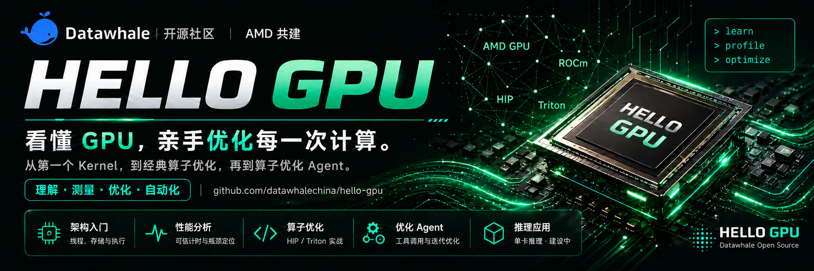

<div align="center">
  
  <p><strong>看懂 GPU，亲手优化每一次计算 🚀</strong></p>
</div>

<div align="center">

*以硬件为起点 · 以 profiling 为证据 · 以优化为手段 · 以 Agent 自动化为终点*

</div>

<div align="center">

<a href="https://datawhalechina.github.io/hello-gpu/"></a> | <a href="https://datawhalechina.github.io/hello-gpu/atlas/"></a> | <a href="./notebooks/README.md"></a> | <a href="https://datawhalechina.github.io/hello-gpu/cloud/amd-radeon-cloud/"></a> | <a href="https://datawhalechina.github.io/hello-gpu/cloud/aup-learning-cloud/"></a>

</div>

<p align="center">
  
  &nbsp;&nbsp;&nbsp;&nbsp;
  
</p>

> [!CAUTION]
> ⚠️ Alpha 内测版本警告：此为早期内部构建版本，尚不完整且可能存在错误，欢迎大家提 Issue 反馈问题或建议。

&emsp;&emsp;随着大模型和多模态模型快速发展，**AI Infra** 已经成为连接算法、系统与硬件的关键方向。很多学习者会使用模型、会调用框架，可一旦模型跑得慢，问题就变成了：GPU 上真正执行的是哪些 kernel？瓶颈在访存、计算，还是别的地方？一个算子从 naive 版本到优化版，到底改了什么才变快？改完之后，是真的更快了，还是只是测量方式变了？

&emsp;&emsp;然而，**会调用模型并不等于看得懂性能**。这些问题都落在 GPU 算子优化的范围里，靠调参数解决不了，必须走到 GPU 执行那一层才能看清全貌。市面上的 GPU 学习资料大多默认从 CUDA 起步，也常把算子当成知识点逐个讲完就结束，很少把「测量 → 定位 → 修改 → 再测」的完整链路讲透，更少继续追问：这套流程能不能交给 Agent 自动完成？

&emsp;&emsp;**hello-gpu** 正是为这条路径而生。本教程以消费级显卡 **AMD Radeon RX 9070 XT** 为实验平台，带你从**理解 GPU 硬件如何执行**出发，学会用 **benchmark 与 profiling** 找到性能瓶颈，再亲手把 Element-Wise、Reduction、Softmax、GEMM、Attention、RMSNorm 等经典算子从正确基线一步步优化，最终构建一个**算子优化 Agent**，自动完成性能分析、优化建议、代码修改、benchmark 和报告生成。

&emsp;&emsp;**本教程不是简单介绍工具，而是希望帮助读者建立 GPU 工程的核心思维：以硬件为起点，以 profiling 为证据，以优化为手段，以 Agent 自动化为终点。任何人都可以提出 issue 或是提交 PR，共同构建维护这个项目。**

> &emsp;&emsp;当前安装环境统一为 **Radeon RX 9070 XT + ROCm 10.0 + 原生 Ubuntu 24.04**。已发布的历史实验保留采集时的软件版本与原始数据。其他 AMD GPU 可以参考方法论，但性能数字和工具可用性需要单独实测确认，换卡流程见[附录 B](https://datawhalechina.github.io/hello-gpu/appendix/appendix-b-switch-gpu/)。

> &emsp;&emsp;***学习建议：建议先完成[第 1 章 环境准备](https://datawhalechina.github.io/hello-gpu/part0-intro/chapter1/)，依次确认 ROCm 能看到 GPU、PyTorch ROCm 可用、最小 HIP 程序能编译运行；手边暂时没有 AMD 显卡，也可以先在 [AMD 云算力平台](https://datawhalechina.github.io/hello-gpu/cloud/) 上动手。之后按「硬件 → Profiling → 算子 → Agent」的顺序学习：先学会看数据，再动手改代码。还不熟悉 Thread、Block、Program、Tile 的同学，进入第 2 篇前可以先读[附录 D：HIP 与 Triton 的编程范式](https://datawhalechina.github.io/hello-gpu/appendix/programming-models/)。按每天 2–3 小时计，完整学完大约需要 2–3 周。***

### Notebook 动手学习：打开就能跑的 GPU 实验

&emsp;&emsp;不想先读完整篇正文？可以直接从 **[Notebook 学习入口](./notebooks/README.md)** 开始。Notebook 与正文小节对齐，目前提供**第 0–8 章与第 14–17 章，共 13 章**，每章按「解释 → 图 → 短代码 → 观察 → 练习」展开。在已准备好的云环境中选择 Python 3 内核即可逐章运行：HIP kernel 保留在教学单元中，直接用 PyTorch Tensor 调用，重复的编译、计时和绘图交给公共包 `hello_gpu` 处理。

```cpp
%%hip vector_add --entry vector_add
__global__ void vector_add(const float* a, const float* b, float* out, int n) {
    int64_t i = static_cast<int64_t>(blockIdx.x) * blockDim.x + threadIdx.x;
    if (i < n) out[i] = a[i] + b[i];
}
```

```python
a = torch.randn(4097, device="cuda", dtype=torch.float32)
b = torch.randn_like(a)
c = vector_add(a, b, block=256)
torch.testing.assert_close(c, a + b)
```

&emsp;&emsp;其中 `device="cuda"` 是 ROCm 版 PyTorch 沿用的接口名称。想先体验完整流程，可以从[第 4 章：第一个程序 + 性能分析](./notebooks/part0-intro/chapter4/chapter4.ipynb)开始，也可以按[章节清单](./notebooks/README.md#章节入口)顺序学习。第 14–17 章默认使用手写动作与教学策略，不调用在线模型也能完整体验 Agent 的候选闭环。

### 最新动态

- *2026.10.12:* Notebook 新增第 14–17 章 **Agent 交互课程**：从手动注册工具、搭建候选闭环到多轮优化，默认不调用在线模型也能完整运行。详见 [Notebook 学习入口](./notebooks/README.md)。

- *2026.10.9:* **[Notebook 动手学习](./notebooks/README.md) 上线**：第 0–8 章可在已准备好的云环境中逐章运行，HIP kernel 直接用 PyTorch Tensor 调用。

- *2026.9.19:* 全书实验环境统一升级到 **ROCm 10.0**（Radeon RX 9070 XT + 原生 Ubuntu 24.04），[附录 B · 换一张卡](https://datawhalechina.github.io/hello-gpu/appendix/appendix-b-switch-gpu/) 同步改写为 ROCm 10.0 的 GPU 架构切换指南。

- *2026.9.13:* 教程站点全新改版，上线 **[GPU 图谱](https://datawhalechina.github.io/hello-gpu/atlas/)**：沿统一时间线探索 AMD GPU 的架构演进、芯片拓扑与计算单元结构。

- *2026.8.10:* 第 3 篇「Agent（算子层）」完成第 14–17 章的本地 Agent 实现与实测文档。

- *2026.7.19:* 第 2 篇「经典算子与 Kernel 实战」上线，用六章逐类拆解经典 GPU 算子的优化路径。

### 算子实战一览

<p align="center">
  <strong>✨ 六类经典算子：正确基线 · Profiling 定位 · HIP / Triton 双路线优化 ✨</strong><br>
  <em>按数据依赖的复杂度递进 · 每章配套可手算的小例子、算法交互动画与实测记录</em><br>
  <a href="https://datawhalechina.github.io/hello-gpu/part2-kernels/">第 2 篇导读</a> · <a href="https://datawhalechina.github.io/hello-gpu/appendix/programming-models/">附录 D：HIP 与 Triton 的编程范式</a>
</p>

<table align="center" border="0" cellspacing="0" cellpadding="0" style="border-collapse: collapse; border: none !important;">

  <tr>
    <td colspan="2" align="center" style="border: none !important;"><strong>Element-Wise · Vector Add</strong></td>
  </tr>
  <tr>
    <td valign="top" width="50%" style="border: none !important;">
      • 独立数据分工与访存连续性<br>
      • 地址排列、grid、float4 与 Triton tile 实测<br>
    </td>
    <td valign="top" width="50%" style="border: none !important;">
      • <a href="https://datawhalechina.github.io/hello-gpu/part2-kernels/chapter8/">第 8 章 教程正文</a><br>
      • <a href="./code/part2-kernels/chapter8">HIP / Triton 实验代码</a><br>
      • <a href="./notebooks/part2-kernels/chapter8/chapter8.ipynb">Notebook 动手实验</a><br>
    </td>
  </tr>
  <tr>
    <td colspan="2" align="center" style="border: none !important;"><strong>Reduction · Sum Reduction</strong></td>
  </tr>
  <tr>
    <td valign="top" width="50%" style="border: none !important;">
      • 树状归约依赖与 LDS 局部累加<br>
      • 块内求和与跨块合并：HIP 合并方案 / Triton program 分工<br>
    </td>
    <td valign="top" width="50%" style="border: none !important;">
      • <a href="https://datawhalechina.github.io/hello-gpu/part2-kernels/chapter9/">第 9 章 教程正文</a><br>
      • <a href="./code/part2-kernels/chapter9">HIP / Triton 实验代码</a><br>
    </td>
  </tr>
  <tr>
    <td colspan="2" align="center" style="border: none !important;"><strong>Normalization · 行级 Softmax</strong></td>
  </tr>
  <tr>
    <td valign="top" width="50%" style="border: none !important;">
      • 减去行最大值，避免指数溢出<br>
      • 行内协作、多阶段融合与 Triton 执行配置<br>
    </td>
    <td valign="top" width="50%" style="border: none !important;">
      • <a href="https://datawhalechina.github.io/hello-gpu/part2-kernels/chapter10/">第 10 章 教程正文</a><br>
      • <a href="./code/part2-kernels/chapter10">HIP / Triton 实验代码</a><br>
    </td>
  </tr>
  <tr>
    <td colspan="2" align="center" style="border: none !important;"><strong>GEMM-Like · Matmul</strong></td>
  </tr>
  <tr>
    <td valign="top" width="50%" style="border: none !important;">
      • 2D 分块与输入复用<br>
      • HIP LDS、Triton tile 与 program 分组<br>
    </td>
    <td valign="top" width="50%" style="border: none !important;">
      • <a href="https://datawhalechina.github.io/hello-gpu/part2-kernels/chapter11/">第 11 章 教程正文</a><br>
      • <a href="./code/part2-kernels/chapter11">HIP / Triton 实验代码</a><br>
    </td>
  </tr>
  <tr>
    <td colspan="2" align="center" style="border: none !important;"><strong>Fusion · Attention（前向教学版）</strong></td>
  </tr>
  <tr>
    <td valign="top" width="50%" style="border: none !important;">
      • 消除中间矩阵的显存物化<br>
      • 在线 Softmax 与 key 分块的收益和代价<br>
    </td>
    <td valign="top" width="50%" style="border: none !important;">
      • <a href="https://datawhalechina.github.io/hello-gpu/part2-kernels/chapter12/">第 12 章 教程正文</a><br>
      • <a href="./code/part2-kernels/chapter12">HIP / Triton 实验代码</a><br>
    </td>
  </tr>
  <tr>
    <td colspan="2" align="center" style="border: none !important;"><strong>综合实战 · Fused RMSNorm</strong></td>
  </tr>
  <tr>
    <td valign="top" width="50%" style="border: none !important;">
      • 平方和归约、缩放因子广播与逐元素权重<br>
      • 行内线程数、warps 与多行 program 配置<br>
    </td>
    <td valign="top" width="50%" style="border: none !important;">
      • <a href="https://datawhalechina.github.io/hello-gpu/part2-kernels/chapter13/">第 13 章 教程正文</a><br>
      • <a href="./code/part2-kernels/chapter13">HIP / Triton 实验代码</a><br>
    </td>
  </tr>
</table>

## 项目意义

&emsp;&emsp;什么是 GPU 算子优化？

> GPU 算子优化是让 GPU 上的计算单元高效运行起来的那一整套工程能力。它把算法、kernel、访存模式与硬件资源串成一条链路——只盯着其中一层，往往看不清完整问题。

&emsp;&emsp;模型越来越大，推理越来越贵，“跑得动”之后紧接着就是“跑得快”。然而，大多数 GPU 学习资料默认从 CUDA 起步，不少教程停留在“怎么运行某个工具”或“某个算子的官方实现”上：看起来学了很多知识点，真正面对一个慢 kernel 时，却说不清它慢在哪里、证据在哪里、改动是否真的有效。

&emsp;&emsp;本项目选择 **AMD Radeon RX 9070 XT（RDNA4）** 作为实验平台：它是易获得、成本较低的消费级显卡，在原生 Linux + ROCm 上经社区和官方验证可用。**这不是为了“反 CUDA”，而是希望你借这条路线，把优化视角练得更通用**——数据是否连续访问、算子是计算瓶颈还是访存瓶颈、kernel launch 开销是否值得关注、profiling 结果能否撑起优化结论，这些问题在任何平台上都会出现，变的只是工具名、术语和实现细节。

&emsp;&emsp;围绕这条主线，本教程坚持三个关键词：

| 关键词 | 含义 | 你会怎么练 |
| ---- | ---- | ---- |
| **Profiling-Driven** | 先学会「看数据」，再学「改代码」 | 写 benchmark、看 timeline、读 profiling 报告 |
| **刷题导向** | 每个算子都是从 naive 到优化的完整案例 | Reduction / Softmax / GEMM / Attention 一路优化下来 |
| **Agent-Driven** | 把「人做的优化流程」交给 Agent 自动化 | 搭一个能自动 profiling、改代码、跑分的 Agent |

&emsp;&emsp;本教程聚焦**单卡上的算子优化 + Agent 自动化**；多卡通信、分布式训练、服务化与集群部署等主题不在本书范围内。

&emsp;&emsp;***我们希望让每一位手握一块显卡的学习者，都能看懂 GPU 在做什么，并亲手让每一次计算变得更快。***

## 项目受众

&emsp;&emsp;本项目适合以下学习者：

* 想进入 AI Infra / AI 系统 / 推理优化 / 算子优化方向的学生和开发者；
* 有 Python / Linux 基础，但对 GPU、ROCm、AI 编译器不熟悉的初学者；
* 做过模型训练或部署，但不知道模型为什么跑得慢、怎么优化的工程师；
* 想基于 AI Agent 自动完成 profiling、benchmark、代码调优和报告生成的开发者；
* 希望了解 AMD GPU / ROCm 生态，而不是只学习 CUDA 体系的学习者。

> &emsp;&emsp;你不需要有 GPU 编程经验，但最好具备基础 Python、Linux 命令行和深度学习概念。

## 项目规划及进展

&emsp;&emsp;全书沿着「**理解硬件 → 学会 profiling → 手写算子优化 → 用 Agent 自动化**」的主线组织，共 5 篇正文与 4 个附录。每一篇都建立在前一篇的基础上，建议按顺序学习，熟悉之后再按主题回看。

### 项目结构

```
hello-gpu/
├── docs/                      # VitePress 教程站点源文件
│   ├── part0-intro/           # 第 0 篇：入门与硬件速通
│   ├── part1-profiling/       # 第 1 篇：Profiling 实战
│   ├── part2-kernels/         # 第 2 篇：经典算子与 Kernel 实战
│   ├── part3-agent/           # 第 3 篇：Agent（算子层）
│   ├── part4-models-agent/    # 第 4 篇：真实模型 + Agent
│   ├── appendix/              # 附录 A–D
│   ├── atlas/                 # GPU 图谱入口
│   ├── cloud/                 # AMD 云算力资源
│   └── .vitepress/            # 站点配置与全书大纲（outline.mjs）
├── code/                      # 各篇实验代码、uv 环境与实验记录
├── notebooks/                 # Notebook 动手学习
├── apps/gpu-atlas/            # GPU 图谱（AMD 展馆）单文件页面
└── scripts/                   # 环境配置、构建与检查脚本
```

### Part 0. Intro - 入门与硬件速通

<p align="center">
  <strong>🧭 入门与硬件速通</strong><br>
  <em>跑通环境，建立硬件直觉 · 建议用时 1–2 天</em><br>
  📖 <strong><a href="https://datawhalechina.github.io/hello-gpu/part0-intro/chapter0/">开始学习第 0 篇</a></strong>
</p>

<table align="center" border="0" cellspacing="0" cellpadding="0" style="border-collapse: collapse; border: none !important;">
  <tr>
    <td valign="top" width="50%" style="border: none !important;" align="center">
      • 教程定位、为什么选 RX 9070 XT 与学习路线<br>
      • 三道门验证环境：ROCm 识别 GPU → PyTorch ROCm → 最小 HIP 程序<br>
      • 编程模型与 wavefront 执行：线程层级、数据索引与硬件执行单元<br>
      • 数据存储与访问：数据位置、成组访问、共享同步与访存等待<br>
      • 第一个 HIP 程序：向量加法、结果验证与 GPU 计时
    </td>
  </tr>
</table>

### Part 1. Profiling - Profiling 实战

<p align="center">
  <strong>🔍 Profiling 实战</strong><br>
  <em>用数据说明 kernel 慢在哪里 · 建议用时 2–3 天</em><br>
  📖 <strong><a href="https://datawhalechina.github.io/hello-gpu/part1-profiling/chapter5/">开始学习第 1 篇</a></strong>
</p>

<table align="center" border="0" cellspacing="0" cellpadding="0" style="border-collapse: collapse; border: none !important;">
  <tr>
    <td valign="top" width="50%" style="border: none !important;" align="center">
      • benchmark 与可信计时：预热、重复统计与有效带宽<br>
      • 用 rocprofv3 记录 kernel 执行，读懂 kernel trace<br>
      • 设计公平对照，分清证据能说明什么、还不能说明什么<br>
      • 读懂 Roofline 图：结合算术强度与参考线，提出可检验的瓶颈假设
    </td>
  </tr>
</table>

### Part 2. Kernels - 经典算子与 Kernel 实战

<p align="center">
  <strong>⚙️ 经典算子与 Kernel 实战</strong><br>
  <em>把一个 kernel 从正确基线一步步优化 · 建议用时 5–7 天</em><br>
  📖 <strong><a href="https://datawhalechina.github.io/hello-gpu/part2-kernels/">开始学习第 2 篇</a></strong>
</p>

<table align="center" border="0" cellspacing="0" cellpadding="0" style="border-collapse: collapse; border: none !important;">
  <tr>
    <td valign="top" width="50%" style="border: none !important;" align="center">
      • Element-Wise → Reduction → Normalization → GEMM-Like → Fusion → Fused RMSNorm<br>
      • HIP / Triton 双路线：同一数学问题与正确性标准，各自沿最自然的路线优化<br>
      • 一轮只改一个核心设计选择，正确性永远先于性能<br>
      • 区分正确性参考、路线基线与 PyTorch 工业级参照<br>
      • 配套算法交互动画、一键实验脚本与原始测量记录
    </td>
  </tr>
</table>

### Part 3. Agent - Agent（算子层）

<p align="center">
  <strong>🤖 Agent（算子层）</strong><br>
  <em>让 Agent 生成、测量、裁决并记录候选 · 建议用时 3–4 天</em><br>
  📖 <strong><a href="https://datawhalechina.github.io/hello-gpu/part3-agent/chapter14/">开始学习第 3 篇</a></strong>
</p>

<table align="center" border="0" cellspacing="0" cellpadding="0" style="border-collapse: collapse; border: none !important;">
  <tr>
    <td valign="top" width="50%" style="border: none !important;" align="center">
      • 从一次手动优化理解模型、工具与反馈循环<br>
      • 工具封装：用结构化接口连接正确性、计时、Roofline 瓶颈分析与接受判定<br>
      • Agent 设计：一项假设对应一份候选，管理候选状态并判断何时停止<br>
      • 多轮优化实战：固定基线、读懂搜索曲线、独立复测并写出可核对的报告
    </td>
  </tr>
</table>

### Part 4. Models + Agent - 真实模型 + Agent

<p align="center">
  <strong>🚀 真实模型 + Agent</strong><br>
  <em>让 Agent 对真实模型做性能优化 · 🚧 建设中</em><br>
  📖 <strong><a href="https://datawhalechina.github.io/hello-gpu/part4-models-agent/chapter18/">开始学习第 4 篇</a></strong>
</p>

<table align="center" border="0" cellspacing="0" cellpadding="0" style="border-collapse: collapse; border: none !important;">
  <tr>
    <td valign="top" width="50%" style="border: none !important;" align="center">
      • YOLO：ONNX / MIGraphX 部署，Agent profiling 找瓶颈、改配置与算子并对比<br>
      • 小模型 LLM 解码：LFM2.5-8B-A1B（GGUF 量化）与 decode 算子视角<br>
      • Agent 优化 KV cache 访问与精度选择，明确单卡边界
    </td>
  </tr>
</table>

### Appendix - 附录与配套资源

<p align="center">
  <strong>📚 附录与配套资源</strong><br>
  <em>环境细节 · 换卡指南 · 底层视角 · 编程范式</em><br>
  📖 <strong><a href="https://datawhalechina.github.io/hello-gpu/curriculum/">浏览全书目录</a></strong>
</p>

<table align="center" border="0" cellspacing="0" cellpadding="0" style="border-collapse: collapse; border: none !important;">
  <tr>
    <td valign="top" width="50%" style="border: none !important;" align="center">
      • <a href="https://datawhalechina.github.io/hello-gpu/appendix/appendix-a-env-install/">附录 A · 环境安装细节与常见坑</a><br>
      • <a href="https://datawhalechina.github.io/hello-gpu/appendix/appendix-b-switch-gpu/">附录 B · 换一张卡：切换 ROCm 10.0 的 GPU 架构</a><br>
      • <a href="https://datawhalechina.github.io/hello-gpu/appendix/appendix-c-kfd-bare-metal/">附录 C · 裸金属视角：绕过 HIP 直接写 AQL</a><br>
      • <a href="https://datawhalechina.github.io/hello-gpu/appendix/programming-models/">附录 D · HIP 与 Triton 的编程范式</a><br>
      • <a href="https://datawhalechina.github.io/hello-gpu/atlas/">GPU 图谱</a> · <a href="https://datawhalechina.github.io/hello-gpu/cloud/">AMD 云算力资源</a>
    </td>
  </tr>
</table>

## 目录

> 全书共 5 篇、20 章。显示章号由 `docs/.vitepress/outline.mjs` 自动生成，新增章节后运行 `npm run docs:sync-outline` 即可同步 README 与站点导航。

| 章节名 | 简介 | 状态 |
| ---- | ---- | ---- |
| **第 0 篇：入门与硬件速通** | | |
| [第 0 章 写给读者的话](https://github.com/datawhalechina/hello-gpu/blob/dev/docs/part0-intro/chapter0/index.md) | 教程定位、为什么选 9070XT、和市面教程差异、学习路线 | 🚧 |
| [第 1 章 环境准备](https://github.com/datawhalechina/hello-gpu/blob/dev/docs/part0-intro/chapter1/index.md) | 9070XT + 原生 Ubuntu + ROCm 10.0 验证、Windows/WSL2 边界、uv 环境、最小 smoke test | 🚧 |
| [第 2 章 GPU 体系结构（上）：编程模型与 wavefront 执行](https://github.com/datawhalechina/hello-gpu/blob/dev/docs/part0-intro/chapter2/index.md) | 从数组加法出发，理解计算流程、线程层级、数据索引与硬件执行 | ✅ |
| [第 3 章 GPU 体系结构（下）：数据存储与访问](https://github.com/datawhalechina/hello-gpu/blob/dev/docs/part0-intro/chapter3/index.md) | 从一次加法理解数据位置、成组访问、共享同步与访存等待 | ✅ |
| [第 4 章 第一个程序 + 性能分析](https://github.com/datawhalechina/hello-gpu/blob/dev/docs/part0-intro/chapter4/index.md) | 从向量加法出发，编写 HIP 程序、验证结果并学习 GPU 计时 | ✅ |
| **第 1 篇：Profiling 实战** | | |
| [第 5 章 benchmark 与可信计时](https://github.com/datawhalechina/hello-gpu/blob/dev/docs/part1-profiling/chapter5/index.md) | 从两种 event 计时方式理解预热、统计和有效带宽 | ✅ |
| [第 6 章 用 rocprof 找到慢在哪里](https://github.com/datawhalechina/hello-gpu/blob/dev/docs/part1-profiling/chapter6/index.md) | 运行向量加法、读懂 kernel trace，并设计公平对照 | ✅ |
| [第 7 章 读懂 Roofline 图](https://github.com/datawhalechina/hello-gpu/blob/dev/docs/part1-profiling/chapter7/index.md) | 从一次加法计算工作点，理解带宽与算力参考线 | ✅ |
| **[第 2 篇：经典算子与 Kernel 实战](https://github.com/datawhalechina/hello-gpu/blob/dev/docs/part2-kernels/index.md)** | | |
| [第 8 章 Element-Wise：逐元素算子](https://github.com/datawhalechina/hello-gpu/blob/dev/docs/part2-kernels/chapter8/index.md) | 从正确基线出发，实测地址排列、grid、float4 与 Triton tile，用逐轮比较决定下一步 | ✅ |
| [第 9 章 Reduction：归约算子](https://github.com/datawhalechina/hello-gpu/blob/dev/docs/part2-kernels/chapter9/index.md) | 从块内求和到完整归约，逐轮比较 HIP 合并方案与 Triton program 分工 | ✅ |
| [第 10 章 Normalization：归一化算子](https://github.com/datawhalechina/hello-gpu/blob/dev/docs/part2-kernels/chapter10/index.md) | 从稳定 Softmax 出发，分别验证行内协作、融合与 Triton 执行配置 | ✅ |
| [第 11 章 GEMM-Like：矩阵乘类算子](https://github.com/datawhalechina/hello-gpu/blob/dev/docs/part2-kernels/chapter11/index.md) | 从点积与复用出发，逐轮验证 HIP LDS、Triton tile 与 program 分组 | ✅ |
| [第 12 章 Fusion：融合算子](https://github.com/datawhalechina/hello-gpu/blob/dev/docs/part2-kernels/chapter12/index.md) | 从 Attention 物化基线出发，验证在线融合与 key 分块的收益和代价 | ✅ |
| [第 13 章 综合实战：Fused RMSNorm](https://github.com/datawhalechina/hello-gpu/blob/dev/docs/part2-kernels/chapter13/index.md) | 从平方和与广播出发，逐轮验证行内线程数、warps 与多行 program | ✅ |
| **第 3 篇：Agent（算子层）** | | |
| [第 14 章 Agent 入门](https://github.com/datawhalechina/hello-gpu/blob/dev/docs/part3-agent/chapter14/index.md) | 从一次手动优化理解模型、工具与反馈循环 | ✅ |
| [第 15 章 工具封装](https://github.com/datawhalechina/hello-gpu/blob/dev/docs/part3-agent/chapter15/index.md) | 用结构化接口连接正确性、计时、瓶颈分析与接受判定 | ✅ |
| [第 16 章 算子优化 Agent 设计](https://github.com/datawhalechina/hello-gpu/blob/dev/docs/part3-agent/chapter16/index.md) | 连接工具、管理候选状态并判断何时结束 | ✅ |
| [第 17 章 多轮优化实战](https://github.com/datawhalechina/hello-gpu/blob/dev/docs/part3-agent/chapter17/index.md) | 用向量加法学习运行、读图、独立复测与报告 | ✅ |
| **第 4 篇：真实模型 + Agent** | | |
| [第 18 章 YOLO 部署 + Agent 自动优化](https://github.com/datawhalechina/hello-gpu/blob/dev/docs/part4-models-agent/chapter18/index.md) | ONNX/MIGraphX 部署、Agent profiling 找瓶颈、改配置/算子、对比 | 🚧 |
| [第 19 章 小模型 LLM 解码 + Agent 自动优化](https://github.com/datawhalechina/hello-gpu/blob/dev/docs/part4-models-agent/chapter19/index.md) | LFM2.5-8B-A1B 量化（GGUF）、decode 算子视角、Agent 优化 KV cache/精度 | 🚧 |

## 贡献者名单

### 核心贡献者

- [刘伟鸿-项目负责人](https://github.com/Weihong-Liu)（Datawhale 成员）

> 注：欢迎更多贡献者加入！

### 其他

- 如果有任何想法可以联系我们，也欢迎大家多多提出 issue
- 特别感谢以下为教程做出贡献的同学！
- 感谢 AMD University Program 对本项目的支持！

<div align="center">
  <a href="https://github.com/datawhalechina/hello-gpu/graphs/contributors">
    
  </a>
</div>

## 参与贡献

&emsp;&emsp;我们欢迎所有形式的贡献！无论是：

* 完善或新增教程章节
* 修复错误与 Bug
* 在其他 AMD GPU 上复跑实验、补充实测数据
* 提出建议与想法

&emsp;&emsp;参与前请先阅读 **[CONTRIBUTING.md](./CONTRIBUTING.md)**（分支模型、Commit 规范与 PR Checklist），日常 PR 请提交到 `dev` 分支。新增或调整章节时，请修改 `docs/.vitepress/outline.mjs` 后运行 `npm run docs:sync-outline`，同步 README 目录与站点导航。

- 如果你发现了一些问题，可以提 Issue 进行反馈，如果提完没有人回复你可以联系[保姆团队](https://github.com/datawhalechina/DOPMC/blob/main/OP.md)的同学进行反馈跟进~
- 如果你想参与贡献本项目，可以提 Pull Request，如果提完没有人回复你可以联系[保姆团队](https://github.com/datawhalechina/DOPMC/blob/main/OP.md)的同学进行反馈跟进~
- 如果你对 Datawhale 很感兴趣并想要发起一个新的项目，请按照[Datawhale 开源项目指南](https://github.com/datawhalechina/DOPMC/blob/main/GUIDE.md)进行操作即可~

## 关注我们

<div align="center">
<p>扫描下方二维码关注公众号：Datawhale</p>

</div>

## LICENSE

<a rel="license" href="http://creativecommons.org/licenses/by-nc-sa/4.0/"></a><br />本作品采用<a rel="license" href="http://creativecommons.org/licenses/by-nc-sa/4.0/">知识共享署名-非商业性使用-相同方式共享 4.0 国际许可协议</a>进行许可。

---

<div align="center">

**让我们一起看懂 GPU，亲手优化每一次计算！** 💪

Made with ❤️ by the hello-gpu community

</div>
